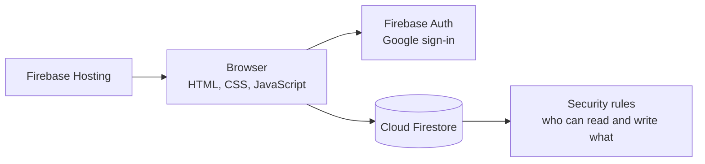

# Recipe Book

**A shared digital cookbook** | JavaScript · Firebase Auth · Cloud Firestore · Firebase Hosting

**Live app:** https://recipe-book-e3d63.web.app

---

## Overview

Recipe Book is a web app for keeping family recipes in one place and cooking from them together. You sign in with Google, save recipes with photos and ratings, organize them by cuisine, track ingredients, and build a shopping list. Teamspaces let a group share one cookbook, with owner, editor, and viewer roles.

It started as a single-user recipe list and grew into a multi-user app with friends, shared workspaces, and access control. The interface is modeled on Notion: a sidebar for switching workspaces, side panels for editing, and inline properties on each recipe.

---

## Features

**Recipes**
- Cover photos with drag-to-reposition, star ratings, cook time, servings, and multiple cuisines per recipe
- Import a recipe from a photo (including iPhone HEIC), a PDF, or a text file. Text is pulled out with Tesseract OCR or PDF.js, then parsed in the browser into a title, ingredient list, and numbered steps
- Download your whole cookbook as a PDF

**Ingredients and shopping**
- Ingredients grouped by category and linked to the recipes that use them
- Mark items "to buy" and export a printable shopping list PDF in one of five designs

**People and teamspaces**
- Usernames, friend search, and friend requests
- Teamspaces with four access levels: default (members only), open (anyone can join), closed (request to join), and private
- Roles: owners manage members and settings, editors change recipes, viewers read
- Copy any recipe between your personal book and your teamspaces
- Installs to a phone home screen as a web app

---

## Architecture



There is no custom server. The browser talks to Firestore directly, which means the security rules are the backend: they are the only thing standing between a user and everyone else's data. That is why they live in this repo and have their own tests.

| Collection | Holds | Belongs to |
|------------|-------|------------|
| recipes, cuisines, ingredients | Cookbook content | One user (`userId`) or one teamspace (`teamspaceId`) |
| teamspaces | Name, access level, members and roles | Owner (`ownerId`) |
| users, usernames | Profiles and reserved usernames | That user |
| friendRequests, friends | Friend system | The two people involved |
| userSettings, teamspaceSettings | Ingredient groups and preferences | A user or a teamspace |

---

## Security

Firebase apps ship their database config to the browser, so anyone can send requests straight to Firestore with a few lines of code and skip the UI completely. I audited the app with that in mind and found that the rules were trusting the UI to enforce things it can't.

**What I found**

| Issue | Impact |
|-------|--------|
| Recipes, cuisines, and ingredients were readable with `allow read: if true` | Anyone on the internet, signed in or not, could download every user's cookbook |
| Any signed-in user could update or delete any teamspace | Someone could add themselves as owner, change access, or delete a group's teamspace |
| Any teamspace document could be edited by any signed-in user | Strangers could change or delete shared recipes |
| Creates didn't check who was creating | Users could plant recipes in someone else's account or send friend requests as someone else |
| Usernames weren't tied to their reservation | Anyone could set their profile name to yours and show up as you in friend search |
| Friendships only had to include you | Anyone could add themselves to your friends list without you accepting |
| Profiles stored each user's email, and profiles are readable for friend search | Any signed-in user could collect every user's email address |
| Saving a teamspace recipe overwrote its `userId` with the editor's | Editing a shared recipe silently moved it into your personal cookbook |
| Joining a teamspace used `arrayUnion` on a map field | Joining replaced the members map with an array, removing everyone, including the owner |
| User-written text went into `innerHTML` unescaped | A recipe title like `` would run code in every teammate's browser (stored XSS) |

**What I changed**
- Rewrote `firestore.rules` around one model: you can read your own data and data in teamspaces you belong to, and only owners and editors can change teamspace content. Nobody can change who owns a document.
- Added a `memberIds` array next to the `members` map so "my teamspaces" is a real query. The old code read every teamspace and filtered in the browser, which only worked because the rules allowed reading everything. The rules now require the two fields to match on every write.
- Spelled out exactly which teamspace updates non-owners can make: leave, join an open teamspace as a viewer, or request to join a closed one for themselves.
- Validated usernames in the rules, since they're shown on other people's screens. A username is only yours if its reservation doc points at you, checked with `getAfter` so signup and renames happen in one batch.
- Stopped storing email in Firestore. The account page shows your email from Firebase Auth, which only you can see, and the rules reject any profile with an `email` field. Older profiles remove theirs the next time that person signs in.
- A friendship can only be created by the person who received the request, in the same write that accepts it. It reuses the request's ID, so one request makes one friendship.
- Escaped user text before rendering, restricted image sources, and stripped scripts and event handlers out of stored SVG icons.
- Wrote [rules tests](tests/firestore.rules.test.js) that run against the Firestore emulator. They check what should work and what shouldn't, including the attacks above.

**Known limitations**
- Share links point to a page that isn't built yet. When it is, recipes will need an explicit `shared` flag and a read rule that allows only those.

---

## Project Structure

```
recipe-book-web-app/
├── public/
│   ├── index.html           # Main app
│   ├── account.html         # Settings: profile, friends, teamspaces
│   ├── app.js               # Workspaces, sidebar, search, sharing, PDF export
│   ├── recipes.js           # Recipe grid, editing, autosave
│   ├── cuisines.js          # Cuisines and icon picker
│   ├── ingredients.js       # Ingredients, groups, shopping list
│   ├── shopping.js          # Shopping list PDF
│   ├── recipe-parser.js     # OCR and PDF import, recipe text parsing
│   ├── account.js           # Profile, friends, teamspaces
│   └── utils.js             # HTML escaping and SVG sanitizing
├── tests/
│   └── firestore.rules.test.js
├── scripts/
│   └── migrate-before-rules.js
├── firestore.rules
└── firebase.json
```

---

## Running Locally

Prerequisites: Node.js 18+, Java 11+ (for the Firestore emulator), and the Firebase CLI.

```bash
git clone https://github.com/sloanatkins/recipe-book-web-app.git
cd recipe-book-web-app
npm install
```

**Run the security rules tests:**

```bash
npm test
```

This starts the Firestore emulator, runs every test in `tests/`, and shuts the emulator down. Nothing touches the live database.

**Serve the app:**

```bash
npx firebase serve --only hosting
```

---

<i>Sloan M. Atkins · University of Miami · CS + Mathematics, Class of 2027</i>
