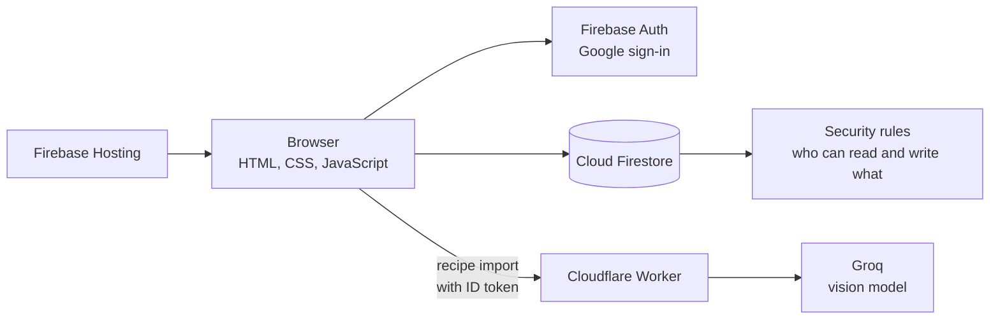
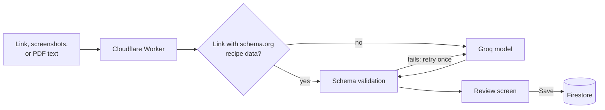
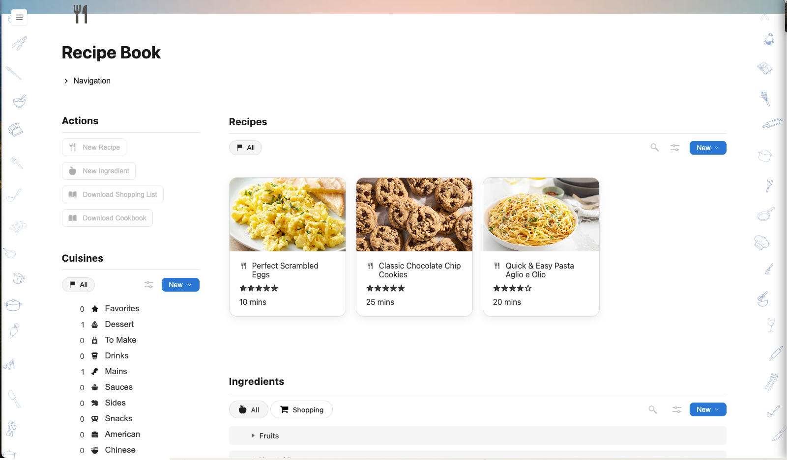
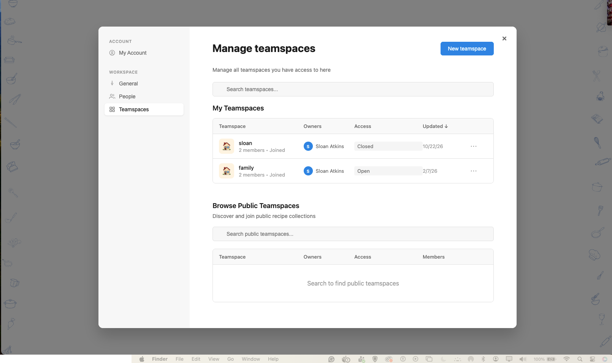
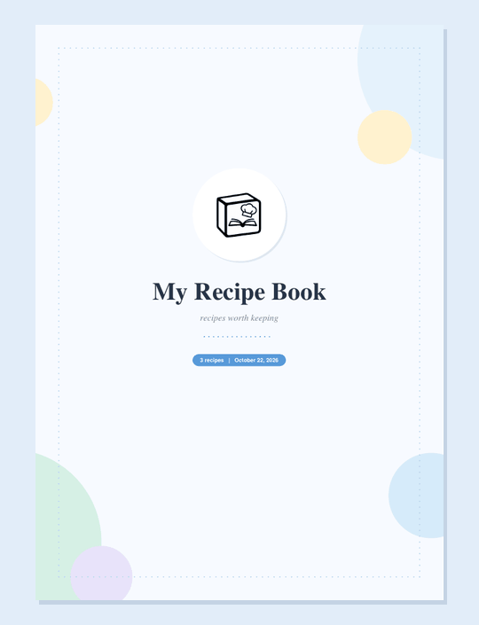

# Recipe Book

**Multi-User Recipe Management App** | JavaScript · Firebase Auth · Cloud Firestore · Firebase Hosting · Cloudflare Workers · Groq · jsPDF

[](https://github.com/sloanatkins/recipe-book-web-app/actions/workflows/rules-tests.yml)

**Live app:** https://recipe-book-e3d63.web.app

---

## Overview

Recipe Book is a web app for keeping family recipes in one place and cooking from them together. You sign in with Google, save recipes with photos and ratings, organize them by cuisine, track ingredients, and build a shopping list. Teamspaces let a group share one cookbook, with owner, editor, and viewer roles.

It started as a single-user recipe list and grew into a multi-user app with friends, shared workspaces, and access control. The interface is modeled on Notion: a sidebar for switching workspaces, side panels for editing, and inline properties on each recipe.

---

## Architecture



The browser talks to Firestore directly, which means the security rules are the backend: they are the only thing standing between a user and everyone else's data. That is why they live in this repo and have their own tests. The one piece of server code is a small Cloudflare Worker for AI recipe import, which exists so the model's API key never reaches the browser.

| Component | Tool |
|-----------|------|
| Frontend | HTML, CSS, vanilla JavaScript |
| Sign-in | Firebase Auth (Google) |
| Database | Cloud Firestore |
| Access control | Firestore security rules |
| Rules tests | Firebase emulator + Mocha |
| Recipe import | Cloudflare Worker + Groq vision model, with Tesseract.js, PDF.js, and heic2any as the offline fallback |
| Import tests | Vitest |
| PDF export | jsPDF |
| Hosting | Firebase Hosting |
| CI | GitHub Actions |

---

## Data Model

| Collection | Holds | Belongs to |
|------------|-------|------------|
| recipes, cuisines, ingredients | Cookbook content | One user (`userId`) or one teamspace (`teamspaceId`) |
| teamspaces | Name, access level, members and roles | Owner (`ownerId`) |
| users, usernames | Profiles and reserved usernames | That user |
| friendRequests, friends | Friend system | The two people involved |
| userSettings, teamspaceSettings | Ingredient groups and preferences | A user or a teamspace |

---

## What This Demonstrates

- Multi-user access control with no backend server: every permission is enforced in Firestore security rules
- Role-based sharing: teamspace owners manage members, editors change recipes, viewers read
- A security audit of my own app, with each finding fixed and covered by a test
- 40 rules tests against the Firestore emulator, run in GitHub Actions on every push
- AI recipe import from a link, screenshots, or a PDF: the site's own recipe data first, an LLM only as a fallback, every result schema-validated and reviewed by the user before it saves
- A Worker that keeps the API key private, verifies Firebase sign-ins, blocks SSRF, and caps daily spend, covered by 78 tests with no live API calls
- A generated cookbook PDF with a cover, a linked table of contents, and page-aware layout
- A one-time data migration script for moving live data to the new rules safely

---

## Security Questions Answered

- **Can someone read another user's recipes?** No. Recipes, cuisines, and ingredients are readable only by their owner and by members of the teamspace they belong to. Before the audit, all three were readable by anyone on the internet.
- **Can a stranger take over or delete a teamspace?** No. Only the owner can change members, roles, or access, and nobody can change who the owner is. Non-owners can only leave, join an open teamspace as a viewer, or request to join a closed one for themselves.
- **Can someone pretend to be another user?** No. A username only counts if its reservation belongs to you, friend requests are checked against those reservations, and a friendship only exists if the other person accepted.
- **Can someone collect other users' emails?** No. Emails are no longer stored in Firestore at all. The app reads your email from Firebase Auth, where only you can see it.
- **Can a recipe title run code in a teammate's browser?** No. User-written text is escaped before it renders, image sources are restricted, and stored SVG icons are stripped of scripts and event handlers.
- **Can someone use the importer to run up the AI bill or reach internal servers?** No. The Worker only answers signed-in users from this site, caps imports per user and model calls per day, and refuses private addresses, including on redirects.

---

## Security Audit

Firebase apps ship their database config to the browser, so anyone can send requests straight to Firestore and skip the UI. I audited the app with that in mind and found the rules were trusting the UI to enforce things it can't.

| Issue | Impact | Fix |
|-------|--------|-----|
| Recipes, cuisines, and ingredients used `allow read: if true` | Anyone could download every user's cookbook | Owner or teamspace member only |
| Any signed-in user could update or delete any teamspace | Someone could make themselves owner or delete a group's teamspace | Owner-only changes, plus three narrow self-service updates |
| Teamspace recipes were editable by any signed-in user | Strangers could change or delete shared recipes | Owners and editors only |
| Creates didn't check who was creating | Users could plant recipes in someone else's account | New docs must carry your own uid |
| Usernames weren't tied to their reservation | Anyone could appear as you in friend search | Username must be reserved by you in the same write |
| Friendships only had to include you | Anyone could add themselves to your friends | Friendship requires an accepted request |
| Profiles stored email and were readable for friend search | Any user could collect every email | Email removed from Firestore entirely |
| Saving a teamspace recipe overwrote its owner | Editing a shared recipe moved it into your own book | Owner preserved on save, and the rules block owner changes |
| Joining used `arrayUnion` on a map field | Joining wiped the member list, owner included | Map entry plus a `memberIds` array kept in sync by the rules |
| User text rendered with `innerHTML` | A recipe title could run code for every teammate | Escaping and sanitizing before render |

**Known limitation:** share links point to a page that isn't built yet. When it is, recipes will need an explicit `shared` flag and a read rule that allows only those.

---

## AI Recipe Import

Paste a recipe link or upload up to three screenshots, and the app turns it into a structured recipe. Nothing saves until you check it on a review screen and hit Save.



- **Links:** most big recipe sites publish schema.org `Recipe` data for Google. The Worker reads that first, which is free, instant, and can't make anything up. Only pages without it go to the model.
- **Screenshots:** sent straight to a vision model. This replaced the old OCR and regex parser for photos, which struggled with Instagram-style screenshots.
- **Validation:** every result has to pass a zod schema (title, servings, time, ingredient sections, steps). If the model's answer fails, the Worker retries once and tells it exactly what was wrong. A second failure returns an error instead of a bad recipe.
- **Fallback:** if the Worker is down or over its limit, file imports fall back to the old in-browser parser, and the review screen says so.

| Concern | How it's handled |
|---------|------------------|
| API key exposure | Stored as a Cloudflare secret. The browser never sees it. |
| Strangers using the importer | Requires a Firebase ID token, verified against Google's public certs with the audience and issuer pinned to this project, and an allowed origin |
| One user running up the bill | 25 imports per user per day |
| Total spend | 300 model calls per day across the whole app |
| Cost per call | Output capped at 2,000 tokens, photos resized to 1,600px, at most 3 per request |
| SSRF | http and https only, no private or link-local IPs, every redirect re-checked, 8 second timeout, 2 MB page cap |
| Prompt injection from page text | Page text is passed as data, the output still has to pass the schema, and a person reviews it before saving |

**What I learned**

- Check for structured data before reaching for an LLM. Reading the site's own recipe data made most link imports free and exact.
- Model output needs a schema, even in JSON mode. It sometimes returned numbers as strings or numbered its own steps, and a cleanup pass plus one targeted retry fixed nearly all of it.
- Any server that fetches a user-supplied URL is an SSRF risk, and the redirects matter as much as the first URL.
- The Firebase Admin SDK doesn't run on Cloudflare Workers, so I verified ID tokens by hand against Google's certs.
- The daily caps live in Workers KV, which isn't atomic. That's fine for a soft limit; a Durable Object would make it exact.

---

## App

**Recipes**
Recipe grid with cover photos, ratings, and cook time. Filter by cuisine, sort, search, and copy any recipe into a teamspace.

<p align="center">
  
</p>---

---

**Teamspaces**
Shared cookbooks with owner, editor, and viewer roles, plus open, closed, and invite-only access.

<p align="center">
  
</p>---

---

**Cookbook PDF**
Every recipe in a workspace as one PDF, with a cover, a linked table of contents, and page numbers. Each recipe is sized to fit on one page when it can.

<p align="center">
  
</p>---

## Project Structure

```
recipe-book-web-app/
├── .github/workflows/       # Rules tests in CI
├── public/
│   ├── index.html           # Main app
│   ├── account.html         # Settings: profile, friends, teamspaces
│   ├── app.js               # Workspaces, sidebar, search, sharing
│   ├── recipes.js           # Recipe grid, editing, autosave, copy to workspace
│   ├── cuisines.js          # Cuisines and icon picker
│   ├── ingredients.js       # Ingredients, groups, shopping list
│   ├── shopping.js          # Shopping list PDF
│   ├── cookbook.js          # Recipe and cookbook PDFs
│   ├── recipe-parser.js     # OCR and PDF import, recipe text parsing
│   ├── recipe-import.js     # AI import modal and review screen
│   ├── account.js           # Profile, friends, teamspaces
│   └── utils.js             # HTML escaping and SVG sanitizing
├── worker/                  # Cloudflare Worker for AI recipe import
│   ├── src/                 # Auth, page fetching, JSON-LD, Groq call, schema, daily caps
│   ├── test/                # 78 Vitest tests with fixture pages and mocked APIs
│   └── wrangler.toml        # Model name, limits, allowed origins
├── tests/
│   └── firestore.rules.test.js
├── scripts/
│   ├── migrate-before-rules.js
│   └── find-stored-emails.js
├── firestore.rules
└── firebase.json
```

---

## Running Locally

**Prerequisites:** Node.js 18+, Java 11+ (for the Firestore emulator)

```bash
git clone https://github.com/sloanatkins/recipe-book-web-app.git
cd recipe-book-web-app
npm install
```

**Run the security rules tests:**

```bash
npm test
```

Starts the Firestore emulator, runs all 40 tests, and shuts it down. Nothing touches the live database.

**Run the import Worker tests:**

```bash
cd worker
npm install
npm test
```

Runs 78 tests against hand-written fixture pages with every network call mocked, so nothing hits a real site or the Groq API.

**Run the importer locally:** put `GROQ_API_KEY=...` in `worker/.dev.vars` (gitignored), run `npx wrangler dev` in `worker/`, and point `RECIPE_IMPORT_URL` in `public/recipe-import.js` at `http://localhost:8787/import`.

**Serve the app:**

```bash
npx firebase serve --only hosting
```

**Deploy:**

```bash
npx firebase deploy --only hosting,firestore:rules
```

**Deploy the import Worker:**

```bash
cd worker
npx wrangler secret put GROQ_API_KEY   # first time only
npx wrangler deploy
```

---

Built with JavaScript, Firebase Auth, Cloud Firestore, Firebase Hosting, Cloudflare Workers, Groq, Tesseract.js, PDF.js, jsPDF, Vitest, and GitHub Actions.

---

<i>Sloan M. Atkins · University of Miami · CS + Mathematics, Class of 2027</i>
