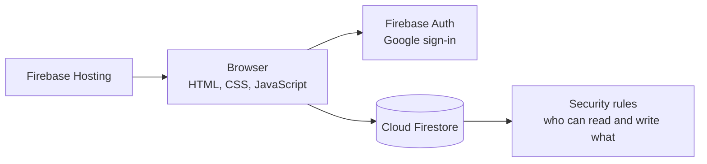
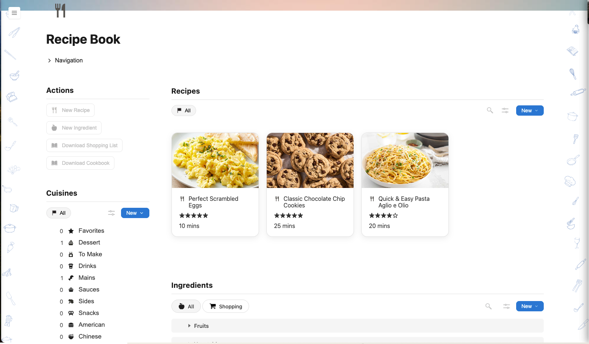
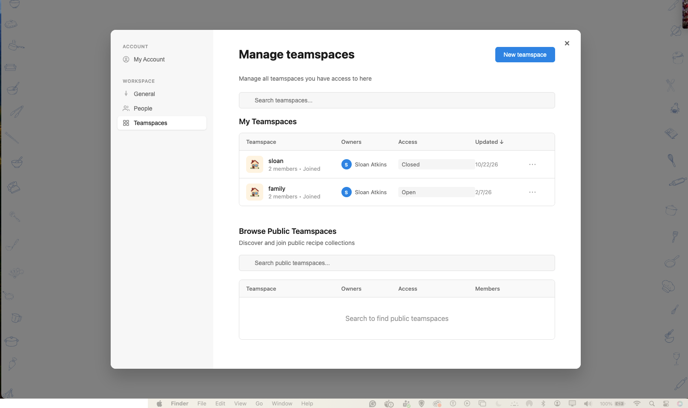
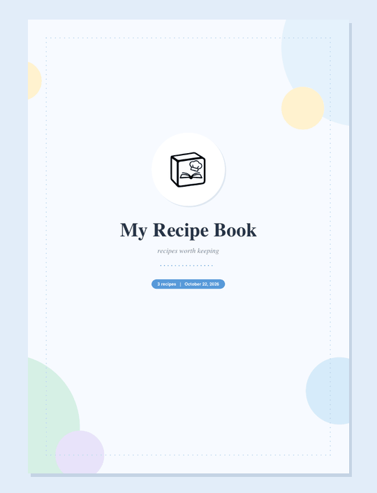

# Recipe Book

**Multi-User Recipe Management App** | JavaScript · Firebase Auth · Cloud Firestore · Firebase Hosting · jsPDF

[](https://github.com/sloanatkins/recipe-book-web-app/actions/workflows/rules-tests.yml)

**Live app:** https://recipe-book-e3d63.web.app

---

## Overview

Recipe Book is a web app for keeping family recipes in one place and cooking from them together. You sign in with Google, save recipes with photos and ratings, organize them by cuisine, track ingredients, and build a shopping list. Teamspaces let a group share one cookbook, with owner, editor, and viewer roles.

It started as a single-user recipe list and grew into a multi-user app with friends, shared workspaces, and access control. The interface is modeled on Notion: a sidebar for switching workspaces, side panels for editing, and inline properties on each recipe.

---

## Architecture



There is no custom server. The browser talks to Firestore directly, which means the security rules are the backend: they are the only thing standing between a user and everyone else's data. That is why they live in this repo and have their own tests.

| Component | Tool |
|-----------|------|
| Frontend | HTML, CSS, vanilla JavaScript |
| Sign-in | Firebase Auth (Google) |
| Database | Cloud Firestore |
| Access control | Firestore security rules |
| Rules tests | Firebase emulator + Mocha |
| Recipe import | Tesseract.js (OCR), PDF.js, heic2any |
| PDF export | jsPDF |
| Hosting | Firebase Hosting |
| CI | GitHub Actions |

---

## Data Model

| Collection | Holds | Belongs to |
|------------|-------|------------|
| recipes, cuisines, ingredients | Cookbook content | One user (`userId`) or one teamspace (`teamspaceId`) |
| teamspaces | Name, access level, members and roles | Owner (`ownerId`) |
| users, usernames | Profiles and reserved usernames | That user |
| friendRequests, friends | Friend system | The two people involved |
| userSettings, teamspaceSettings | Ingredient groups and preferences | A user or a teamspace |

---

## What This Demonstrates

- Multi-user access control with no backend server: every permission is enforced in Firestore security rules
- Role-based sharing: teamspace owners manage members, editors change recipes, viewers read
- A security audit of my own app, with each finding fixed and covered by a test
- 40 rules tests against the Firestore emulator, run in GitHub Actions on every push
- Recipe import from photos, iPhone HEIC images, PDFs, and text files, parsed in the browser
- A generated cookbook PDF with a cover, a linked table of contents, and page-aware layout
- A one-time data migration script for moving live data to the new rules safely

---

## Security Questions Answered

- **Can someone read another user's recipes?** No. Recipes, cuisines, and ingredients are readable only by their owner and by members of the teamspace they belong to. Before the audit, all three were readable by anyone on the internet.
- **Can a stranger take over or delete a teamspace?** No. Only the owner can change members, roles, or access, and nobody can change who the owner is. Non-owners can only leave, join an open teamspace as a viewer, or request to join a closed one for themselves.
- **Can someone pretend to be another user?** No. A username only counts if its reservation belongs to you, friend requests are checked against those reservations, and a friendship only exists if the other person accepted.
- **Can someone collect other users' emails?** No. Emails are no longer stored in Firestore at all. The app reads your email from Firebase Auth, where only you can see it.
- **Can a recipe title run code in a teammate's browser?** No. User-written text is escaped before it renders, image sources are restricted, and stored SVG icons are stripped of scripts and event handlers.

---

## Security Audit

Firebase apps ship their database config to the browser, so anyone can send requests straight to Firestore and skip the UI. I audited the app with that in mind and found the rules were trusting the UI to enforce things it can't.

| Issue | Impact | Fix |
|-------|--------|-----|
| Recipes, cuisines, and ingredients used `allow read: if true` | Anyone could download every user's cookbook | Owner or teamspace member only |
| Any signed-in user could update or delete any teamspace | Someone could make themselves owner or delete a group's teamspace | Owner-only changes, plus three narrow self-service updates |
| Teamspace recipes were editable by any signed-in user | Strangers could change or delete shared recipes | Owners and editors only |
| Creates didn't check who was creating | Users could plant recipes in someone else's account | New docs must carry your own uid |
| Usernames weren't tied to their reservation | Anyone could appear as you in friend search | Username must be reserved by you in the same write |
| Friendships only had to include you | Anyone could add themselves to your friends | Friendship requires an accepted request |
| Profiles stored email and were readable for friend search | Any user could collect every email | Email removed from Firestore entirely |
| Saving a teamspace recipe overwrote its owner | Editing a shared recipe moved it into your own book | Owner preserved on save, and the rules block owner changes |
| Joining used `arrayUnion` on a map field | Joining wiped the member list, owner included | Map entry plus a `memberIds` array kept in sync by the rules |
| User text rendered with `innerHTML` | A recipe title could run code for every teammate | Escaping and sanitizing before render |

**Known limitation:** share links point to a page that isn't built yet. When it is, recipes will need an explicit `shared` flag and a read rule that allows only those.

---

## App

**Recipes**
Recipe grid with cover photos, ratings, and cook time. Filter by cuisine, sort, search, and copy any recipe into a teamspace.

<p align="center">
  
</p>---

---

**Teamspaces**
Shared cookbooks with owner, editor, and viewer roles, plus open, closed, and invite-only access.

<p align="center">
  
</p>---

---

**Cookbook PDF**
Every recipe in a workspace as one PDF, with a cover, a linked table of contents, and page numbers. Each recipe is sized to fit on one page when it can.

<p align="center">
  
</p>---

## Project Structure

```
recipe-book-web-app/
├── .github/workflows/       # Rules tests in CI
├── public/
│   ├── index.html           # Main app
│   ├── account.html         # Settings: profile, friends, teamspaces
│   ├── app.js               # Workspaces, sidebar, search, sharing
│   ├── recipes.js           # Recipe grid, editing, autosave, copy to workspace
│   ├── cuisines.js          # Cuisines and icon picker
│   ├── ingredients.js       # Ingredients, groups, shopping list
│   ├── shopping.js          # Shopping list PDF
│   ├── cookbook.js          # Recipe and cookbook PDFs
│   ├── recipe-parser.js     # OCR and PDF import, recipe text parsing
│   ├── account.js           # Profile, friends, teamspaces
│   └── utils.js             # HTML escaping and SVG sanitizing
├── tests/
│   └── firestore.rules.test.js
├── scripts/
│   ├── migrate-before-rules.js
│   └── find-stored-emails.js
├── firestore.rules
└── firebase.json
```

---

## Running Locally

**Prerequisites:** Node.js 18+, Java 11+ (for the Firestore emulator)

```bash
git clone https://github.com/sloanatkins/recipe-book-web-app.git
cd recipe-book-web-app
npm install
```

**Run the security rules tests:**

```bash
npm test
```

Starts the Firestore emulator, runs all 40 tests, and shuts it down. Nothing touches the live database.

**Serve the app:**

```bash
npx firebase serve --only hosting
```

**Deploy:**

```bash
npx firebase deploy --only hosting,firestore:rules
```

---

Built with JavaScript, Firebase Auth, Cloud Firestore, Firebase Hosting, Tesseract.js, PDF.js, jsPDF, and GitHub Actions.

---

<i>Sloan M. Atkins · University of Miami · CS + Mathematics, Class of 2027</i>
